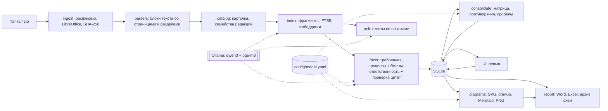

# Архитектура DocAnalyzer AMR/RMS

## Идея

Задача не сводится к «чату с документами». Нужно найти в архиве факты определённых типов: процессы, требования, решения, обмены между системами. Затем привязать их к источникам, разобраться с редакциями и противоречиями и собрать из этого отчёт заданной структуры. Поэтому ядро сервиса — **база знаний проекта**.

**Принципы:**
1. **Трассируемость.** Каждый факт ссылается на документ, страницу и дословную цитату. Цитата проверяется по тексту (`core/extract.py: quote_score`).
2. **Человек в контуре.** Модель предлагает, аналитик подтверждает. В отчёт попадает только подтверждённое.
3. **Всё локально.** Документы и модель работают на одной машине.

## Конвейер

Каждый этап можно перезапускать:
- уже загруженные файлы (по хэшу) не разбираются повторно;
- каждый фрагмент обрабатывается каждым видом фактов один раз (`extraction_log`): можно остановить и продолжить, можно добавить новый вид;
- ручные правки карточек (`card_source = 'manual'`) не перезаписываются;
- решения по противоречиям хранятся по стабильному ключу и переживают пересчёт; если за противоречием появились новые факты, оно открывается снова.

## Данные (SQLite, `core/db.py`)

| Таблица | Что хранит |
|---|---|
| `documents` | файл, хэш, состояние обработки, карточка, семейство редакций, актуальность |
| `blocks` | абзацы, заголовки, таблицы в порядке документа, со страницей и разделом |
| `chunks` + `chunks_fts` | фрагменты для поиска, полнотекстовый индекс, векторы |
| `requirements` | требования к AMR/RMS: цитата, источник, статус ревью |
| `open_questions` | вопросы к заказчику |
| `extraction_log` | какие фрагменты уже обработаны моделью и каким видом фактов |
| `processes` *(v2)* | процесс: триггер, инициатор, роль AMR, откуда/куда, груз, шаги (JSON), цитата, статус ревью |
| `interfaces` *(v2)* | обмен: откуда, куда, что передаётся, протокол, когда; цитата, статус ревью |
| `responsibilities` *(v2)* | функция → система (функции и системы из `config/model.yaml`); цитата, статус ревью |
| `conflicts` *(v2)* | противоречия, изменения между редакциями, пробелы; варианты с источниками; решение аналитика |

## Почему такие решения

- **SQLite + numpy вместо Postgres/Qdrant.** Нулевая установка на Windows, один файл базы. Объёмов архива (тысячи документов, десятки тысяч фрагментов) хватает. При переходе на сервер слой хранения меняется в одном модуле.
- **Ollama.** Ставится на Windows одним установщиком, отдаёт OpenAI-совместимый API, поддерживает JSON-схемы ответа. Для сервера с GPU адрес и модель меняются в настройках.
- **Гибридный поиск (RRF).** Полнотекстовый поиск находит коды и сокращения (EWM, PSA, HU, номера разделов), векторный — перефразировки.
- **Проверка цитат.** Маленькие локальные модели склонны додумывать. Если цитаты нет в тексте, требование не принимается.

## Почему противоречия ищутся правилами, а не моделью

Матрица «функция × система» строится по закрытым справочникам (`config/model.yaml`): модель выбирает
функцию и систему из списка, а не пишет своими словами. Поэтому факты из разных документов
сравниваются напрямую: «за подтверждение доставки в ТЗ отвечает MES, в проектном решении — SAP EWM» —
это противоречие, которое можно показать заказчику с двумя цитатами. Модель 8B на ноутбуке плохо
справляется с прямым вопросом «найди противоречия» по большому архиву, а правила дают объяснимый
и воспроизводимый результат.

## План версий

| Версия | Содержание |
|---|---|
| v1 | загрузка, каталог, редакции, поиск, вопросы со ссылками, требования с ревью, Word/Excel |
| **v2 (сейчас)** | процессы, обмены, матрица ответственности; противоречия, изменения между редакциями и пробелы; схемы (SVG, draw.io, Mermaid, PNG) в интерфейсе и отчёте; оценка качества |
| v3 | OCR сканов, разбор схем Visio как графов, письма .msg и архивы .rar/.7z из коробки, сравнение снимков базы знаний во времени, перенос на GPU-сервер и общая база для команды |

## Оценка качества

Перед сменой модели или промпта: вручную разметить требования в 5–10 документах и сравнить с извлечёнными (точность и полнота). Скрипт — `scripts/eval_requirements.py`, разметка — в `eval/`.
